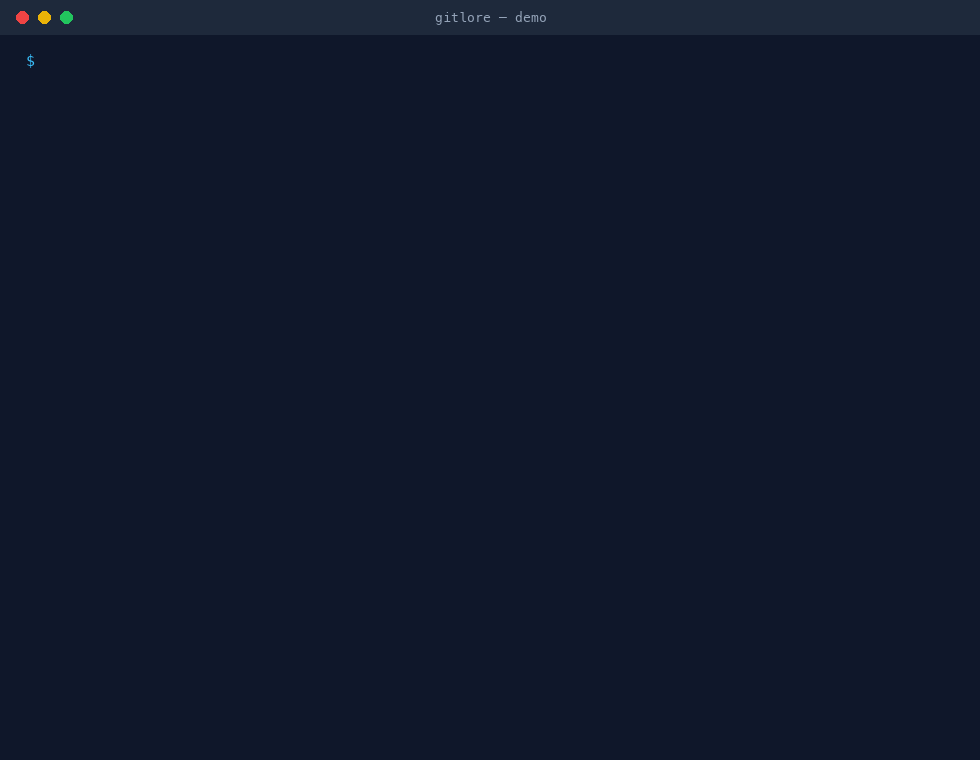
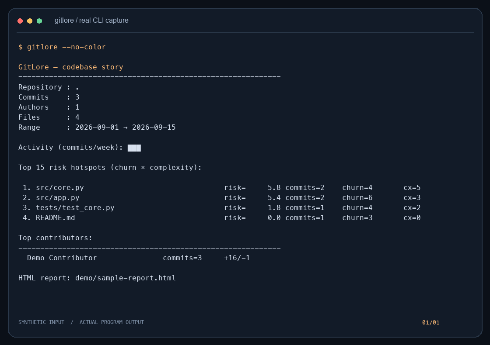
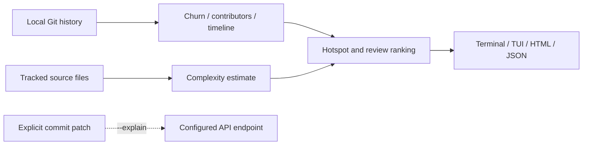

<p align="center"></p>
<h1 align="center">GitLore</h1>
<p align="center"><strong>Find review hotspots in unfamiliar Git histories.</strong></p>

[](https://github.com/LucasYanzy/gitlore/actions/workflows/ci.yml) [](LICENSE) [](https://github.com/LucasYanzy/gitlore/blob/main/pyproject.toml)  [](https://github.com/LucasYanzy/gitlore/stargazers)

[English](README.md) · [简体中文](README.zh-CN.md)



The demo is captured from the real CLI using synthetic data. [Transcript](demo/terminal.txt) · regenerate with `python3 scripts/demo.py`.

## Why

An unfamiliar repository has years of context hidden in Git. GitLore summarizes churn, a lightweight complexity estimate, contributors and activity so you can choose where to start reading.

| Start with | Good for | Where GitLore helps |
|---|---|---|
| `git log` | Read commits in sequence | GitLore aggregates file hotspots and activity. |
| `git shortlog` | Count contributors | GitLore combines contributors with churn and review signals. |

## Quick start

```bash
git clone https://github.com/LucasYanzy/gitlore.git && cd gitlore
python3 -m pip install .
python3 scripts/demo.py
```

Requires Git and Python 3.10+. The install includes Rich and Textual. Optional AI support requires `python3 -m pip install ".[ai]"`; core analysis needs no API key. [Open the generated HTML example](demo/sample-report.html).

## Features

### Rank hotspots

Combine churn and a heuristic complexity estimate. Scores prioritize attention; they are not defect probabilities.

### Review a branch

`--diff main...HEAD` weights changed files by historical risk to suggest a reading order.

### Share a report

Export standalone HTML or JSON, or explore the repository in the Textual TUI.

### Explain on request

`--explain` is optional and uses your configured API endpoint. It sends a commit patch only when explicitly selected.



## Usage

```bash
gitlore --repo /path/to/project
gitlore --since 2026-01-01 --top 10
gitlore --diff main...HEAD
gitlore --html report.html
gitlore --json
gitlore --tui
```

## Architecture



## Privacy and limits

Core analysis stays local. HTML/JSON reports include repository paths and contributor names and must be reviewed before sharing. `--explain` sends up to 12,000 patch characters to the configured endpoint; file contents may contain sensitive data. Installing dependencies can access package registries. See [PRIVACY.md](PRIVACY.md) for data boundaries.

## Development

```bash
python3 -m pip install -e ".[dev]"
python3 -m pytest -q
```

The demo uses a temporary fixture and does not inspect your personal repositories or agent homes.

## Roadmap

- [ ] Improve language-aware complexity estimates.
- [ ] Add interactive per-file history drill-down.

## Contributing

Read [CONTRIBUTING.md](CONTRIBUTING.md). Report reproducible problems in [Issues](https://github.com/LucasYanzy/gitlore/issues). Follow [SECURITY.md](SECURITY.md) for sensitive reports.

## License

[MIT](LICENSE).
