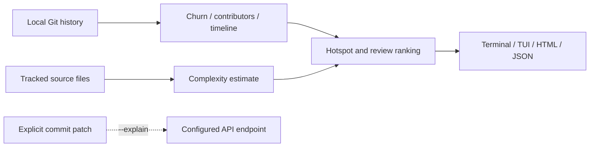

<p align="center"></p>
<h1 align="center">GitLore</h1>
<p align="center"><strong>从陌生仓库的 Git 历史中找到值得优先审阅的位置。</strong></p>

[](https://github.com/LucasYanzy/gitlore/actions/workflows/ci.yml) [](LICENSE) [](https://github.com/LucasYanzy/gitlore/blob/main/pyproject.toml)  [](https://github.com/LucasYanzy/gitlore/stargazers)

[English](README.md) · [简体中文](README.zh-CN.md)


演示来自真实程序输出，输入全部为合成数据。[终端记录](demo/terminal.txt)；运行 `python3 scripts/demo.py` 可复现。

## 为什么需要它

面对陌生仓库，多年的上下文藏在 Git 中。GitLore 汇总修改频率、轻量复杂度估计、贡献者和活动时间线，帮助确定先读哪里。

## 快速开始

```bash
git clone https://github.com/LucasYanzy/gitlore.git && cd gitlore
python3 -m pip install .
python3 scripts/demo.py
```

需要 Git 与 Python 3.10+，安装时包含 Rich 和 Textual。可选 AI 功能需额外安装 `python3 -m pip install ".[ai]"`，核心分析无需 API Key。[查看生成的 HTML 示例](demo/sample-report.html)。

## 功能

### 定位热点

将改动量与启发式复杂度结合。分数用于排序关注点，不代表缺陷概率。

### 审阅分支

`--diff main...HEAD` 用历史风险为当前改动加权，建议阅读顺序。

### 查看与导出

支持独立 HTML、JSON 与基于 Textual 的交互终端界面。

### 按需解释

仅在显式选择 `--explain` 时，才将提交补丁发送到配置的 API 端点。


## 使用

```bash
gitlore --repo /path/to/project
gitlore --since 2026-01-01 --top 10
gitlore --diff main...HEAD
gitlore --html report.html
gitlore --json
gitlore --tui
```

## 架构



## 隐私与边界

核心分析在本地完成。HTML/JSON 报告包含仓库路径与贡献者姓名，分享前必须检查。`--explain` 会将最多 12,000 个字符的补丁发往配置端点，补丁本身仍可能含敏感数据。安装依赖时可能访问包注册表。 详见 [PRIVACY.md](PRIVACY.md)。

## 开发与验证

```bash
python3 -m pip install -e ".[dev]"
python3 -m pytest -q
```

演示只使用临时样例，不会扫描你的个人仓库或代理主目录。

## 路线图

请参阅[英文路线图](README.md#roadmap)，其中只列出尚未实现的工作。

## 贡献与许可

贡献方式见 [CONTRIBUTING.md](CONTRIBUTING.md)，安全问题见 [SECURITY.md](SECURITY.md)。采用 [MIT License](LICENSE)。
